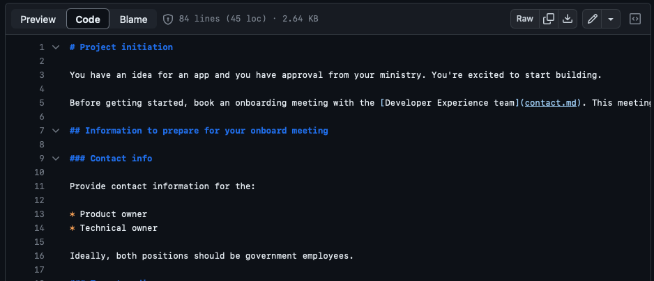
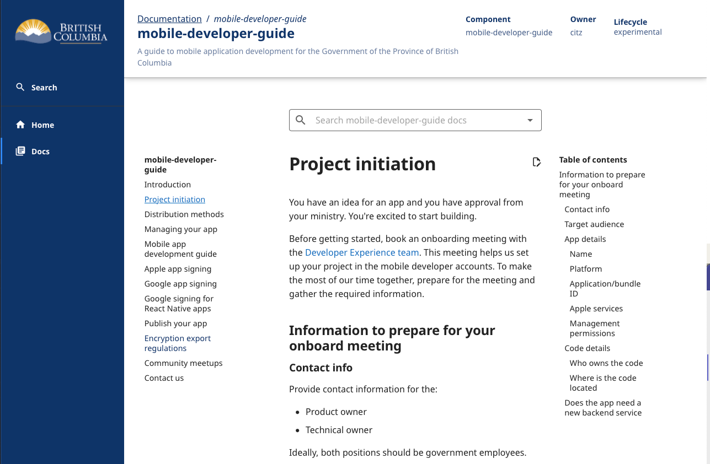
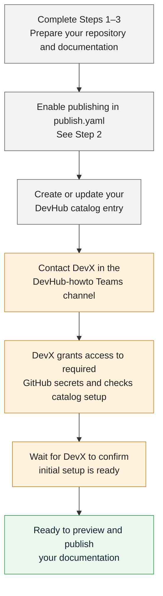
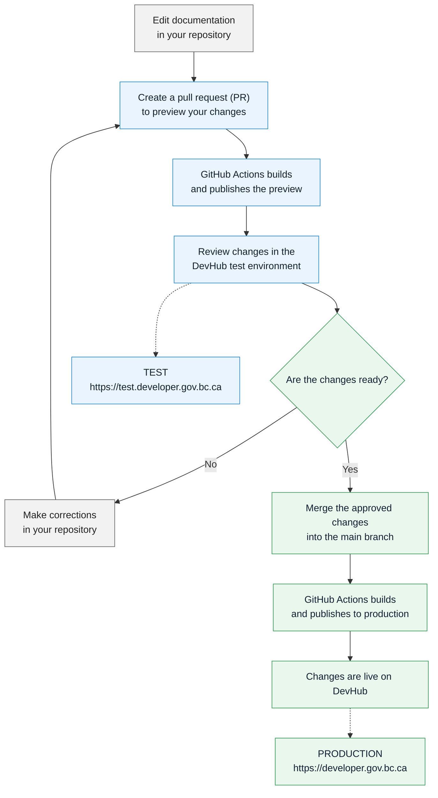

# DevHub Content Partner Guide

Use this guide if your B.C. government team wants to publish technical documentation in DevHub for a product, service, platform or shared component.

!!! note "Already familiar with the process and ready to get started?"
    Use the [DevHub self-service Wizards](https://developer.gov.bc.ca/create?filters%5Bkind%5D=template&filters%5Buser%5D=all) to create a documentation repository or add existing technical documentation to DevHub. 

- Contact the Developer Experience (DevX) team through Developer Community Microsoft Team's channel [DevHub-howto](https://teams.microsoft.com/l/channel/19%3Acd0757bed1244bd5ac6aa90943828077%40thread.tacv2/DevHub-howto?groupId=a80418da-c27b-406e-89ab-7695b61924d8&tenantId=6fdb5200-3d0d-4a8a-b036-d3685e359adc) if you get stuck 

Or 
- [Create a request ticket](https://citz-do.atlassian.net/servicedesk/customer/portal/2/group/9/create/764) when your documentation is ready for initial publication or you need changes to an existing publishing configuration

## About DevHub

DevHub is a central place for B.C. government technologists and developers to find tools, services and technical documentation. It helps them also find the information they need to build, maintain and support digital services. 

## Write and format your documentation

DevHub uses Markdown, a simple text format for writing structured content. Markdown supports headings, links, lists, tables, images and diagrams.

DevHub also uses an `mkdocs.yml` configuration file to control your documentation's navigation. The self-service Wizards provide a starting point for your repository configuration.

Refer to the [DevHub Content Syntax Guide](content-syntax-guide.md) for formatting requirements and examples. You can also learn more about Markdown from pages like [Markdown's creator](https://daringfireball.net/projects/markdown/), the Markdown ["cheat sheet"](https://www.markdownguide.org/cheat-sheet/) and [commonmark.org tutorial](https://commonmark.org/help/tutorial/).

## Choose an editor

!!! Warning "Always verify guidance by the [Appropriate Use Policy](https://www2.gov.bc.ca/gov/content/governments/services-for-government/policies-procedures/appropriate-use-policy) for approved software."

You can edit Markdown files directly in GitHub or use a desktop editor.

### GitHub web interface 

Use GitHub's web interface to edit files in your repository. This is a simple option for making quick changes without installing additional software. You can edit a file, review your changes and save them to your repository.

### Desktop code or text editor with Markdown plugin

You can also use a desktop editor with Markdown support, such as [Visual Studio Code (VS Code)](https://code.visualstudio.com). The editors can help you write and preview Markdown. You will still need to save your changes to GitHub.

### Dedicated desktop Markdown editor

Where appropriate, you can install a dedicated Markdown editor on your computer to write and edit documentation.

The list of Markdown editors includes [many options](https://github.com/mundimark/awesome-markdown-editors) examples include: VSCode, Git CLI and GitHub Desktop. 

You will still need to save your files to GitHub. If you're comfortable using terminal commands, you can use a [Git command-line client](https://git-scm.com/downloads). If you prefer a graphical interface, you can use tools such as [GitHub Desktop](https://desktop.github.com).

## See how DevHub displays documentation

DevHub applies styling to your Markdown content to make it consistent with the B.C. government's visual identity.

It also provides search and page-level navigation to help readers find information.

The images below provide an example of how a Markdown snippet in GitHub (first image) is displayed within DevHub (second image).

## Understand the publishing workflow

Your team maintains its documentation in its own GitHub repository. The Developer Experience (DevX) team maintains DevHub and the tools that publish your content.

Once your repository is configured for publishing, you can update your documentation independently without waiting for DevX to make changes.

The publishing process has 3 main steps:

- **Write and edit**: Create or update your documentation in your team's GitHub repository
- **Preview:** Save your files to a preview branch (any branch other than a repo's default/main branch) and create a [pull request](https://docs.github.com/en/pull-requests/reference/pull-requests) in GitHub. After a few moments, it will then be available for review on the preview instance: [https://test.developer.gov.bc.ca](https://test.developer.gov.bc.ca/) of DevHub. Note: the PR with the most recent commit will be displayed on the preview site.
- **Publish:** Merge your approved pull request to the main branch to publish them to the live DevHub site

The following sections explain how to set up your repository and publish your documentation for the first time.

For those interested in the automated aspect of the process above, it is provided by a purpose-built GitHub "Action" that we have create to simplify things for our content partners, and maintain consistency in the publishing process. It takes care of converting your Markdown content into an HTML format that is compatible with DevHub, packaging it up, and transferring it to a location that DevHub can access it.

The Developer Experience team configures access to the publishing workflow during the initial setup process. Refer to the section: [Create and publish your documentation in DevHub](#create-and-publish-your-documentation-in-devhub) for guidance and details.

## Confirm your content belongs in DevHub

DevHub contains technical documentation that helps technologists use or support a product, service, platform or shared component. Business-oriented and other non-technical content belongs on the [Connected Services BC](https://digital.gov.bc.ca) website.

## Create and publish your documentation in DevHub

Follow these steps to create your documentation repository, prepare your content and request initial publication.

### Before you start: Adapt existing documentation for DevHub

If your team already has technical documentation, review it before you set up your repository. DevHub uses Markdown and has specific content and formatting requirements.

Use the [DevHub Content Syntax Guide](content-syntax-guide.md) to identify any changes your existing content needs. If your documentation uses another format, plan how you will convert it to Markdown. If it lives outside GitHub, plan how you will move it into your documentation repository after you create or prepare the repository in Step 1.

You will make these changes in Step 2. If you are starting new documentation, you can skip this prerequisite.

### 1. Create or prepare documentation repository

Start with the [DevHub self-service Wizards - TechDocs](https://developer.gov.bc.ca/create?filters%5Bkind%5D=template&filters%5Buser%5D=all)

Choose the Wizard that matches your situation:

- **Create a technical documentation repo:** Choose this option if your team needs a new GitHub repository for its technical documentation. The Wizard creates a repository with the required files for DevHub

- **Add existing technical documentation to DevHub:** Choose this option if your technical documentation already lives in a GitHub repository you want to keep using. The Wizard adds the required files to that repository

Follow the prompts to provide information about your product, service or component, hosting platform, license and repository. 

### 2. Review the files created by the Wizard

After completing the Wizard, open your repository and review the files it created. Check the documentation structure and navigation, then start adding or updating your content.

#### Enable the publishing workflow

The Wizard creates a `.github/workflows/publish.yaml` file in your repository. Publishing is disabled by default, so you must update this file before your documentation can appear on the DevHub preview or production site.

To enable publishing: 

1. Open `.github/workflows/publish.yaml` in your repository
2. Find the publish: `false` line
3. Change it to publish: `true`
4. Uncomment the lines immediately below it, as indicated in the file

You can refer to the [publishing workflow template](https://github.com/bcgov/devhub-templates/blob/075fe8d8985f6eccf295db095baa9a0399f55bc8/shared/.github/workflows/publish.yaml#L33) for guidance. This link points to the template used by the Wizard. **Make these changes in your own repository's copy of `publish.yaml`, not the template.**

The Developer Experience team (DevX) must also grant your repository access to the GitHub secrets required for publishing. Your documentation will not publish until the workflow is enabled and the required access is configured. More on this in [Step 4](#4-coordinate-your-initial-publishing-setup).

#### Check the documentation licence

The Wizard adds a `LICENSE.md` file with the [Creative Commons Attribution 4.0 International license (CC BY 4.0)](https://creativecommons.org/licenses/by/4.0/) when it creates a new repository.

If you are adding documenation to an existing repository, check that its root directory contains a `LICENSE.md` containing the [license text](https://creativecommons.org/licenses/by/4.0/legalcode.txt).

If your repository contains both code and documentation under different licenses, add a separate license file for the documentation, such as `LICENSE_DOCS.md`. Update your `README.md` to explain which license applies to each.

### 3. Prepare your documentation 

Add your technical documentation to the repository in Markdown format. If you already maintain Markdown documentation, check it against the [DevHub Content Syntax Guide](content-syntax-guide.md).

If your content uses another format or lives outside GitHub, adapt it before publishing. Organize your files and update the navigation configuration as needed.

### 4. Coordinate your initial publishing setup

#### Initial setup at a glance

Complete these steps before publishing your documentation for the first time. You only need to coordinate the initial setup once per repository unless changes to the configuration are needed later.

[Create a service request](https://citz-do.atlassian.net/servicedesk/customer/portal/2/create/764) to coordinate the initial set up. You will need: 

- A link to your GitHub repository URL
- A brief note that your documentation is ready for initial publishing setup

DevX must grant your repository access to the GitHub secrets required by the publishing workflow. The team also needs to confirm that the DevHub catalog entry is ready.

Wait for DevX to confirm that the required access and catalog setup are ready before merging your initial publishing changes into main.

#### Add or update your DevHub catalog entry

The catalog helps DevHub organize information about products, services and documentation.

1. Open the [Developer Experience team catalog repository](https://github.com/bcgov/developer-experience-team/tree/main/developer-portal/catalog)
2. Review existing entries in the `catalog-seed-[dev|test|prod].yml files to find the appropriate file and see how entries are structured
3. Add or update your entry using the repository's format and required fields
4. Open a pull request for your changes, following the repository's contribution process

Check that the entry identifies your offering and points to the correct documentation. If you are unsure which file to edit or how to submit the change, ask the Developer Experience team for help in the [DevHub-howto](https://teams.microsoft.com/l/channel/19%3Acd0757bed1244bd5ac6aa90943828077%40thread.tacv2/DevHub-howto?groupId=a80418da-c27b-406e-89ab-7695b61924d8&tenantId=6fdb5200-3d0d-4a8a-b036-d3685e359adc) channel.

Finally, wait for the Developer Experience team to confirm that the required GitHub secrets are configured and the catalog setup is ready before you merge your publishing changes into `main`.

### 5. Preview your changes and publish your documentation

Preview your documentation before publishing it.

**Preview in DevHub**

1. Save your changes to a branch other than main and create a pull request
2. Open the DevHub [preview environment](https://test.developer.gov.bc.ca/) after the publishing workflow has run
3. Review your content, navigation, links, images and formatting.
Fix any issues you find and preview your changes again

**Preview locally on your computer**

You can also preview your documentation locally using the DevHub TechDocs Publish Docker image. This option generates a preview of your documentation and runs a link check before starting a local preview server.

Review: [How to use the Docker image to preview content locally](https://github.com/bcgov/devhub-techdocs-publish/blob/main/docs/index.md#how-to-use-the-docker-image-to-preview-content-locally) for setup instructions and commands. You can use Docker, Colima or Podman.

Using the preview options allows you see how your documentation would look live on DevHub. This allows you to fix any issues prior to publishing. 

When you're satisfied with the result, commit your changes to a branch and push to GitHub, following your team's GitHub workflow.

This diagram shows the recurring process after your repository has been configured for publishing.

